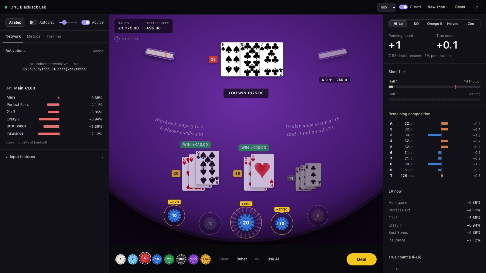

# ONE Blackjack Lab

A faithful simulator of **Pragmatic Play's ONE Blackjack** (as played at Napoleon Casino, Belgium), a neural
network that learns to play it — main bet, bet sizing, the four side bets, insurance and cash-out — and a web lab
that shows everything at once:

* **left** — the network: live activations, input features, Q-values / predicted EVs, agreement with basic strategy,
  session and simulation metrics, training curves;
* **middle** — the table: the shared hand, the crowd's extra cards, dealer, bet spots (Bust Bonus, 21+3, main,
  Perfect Pairs, Crazy 7), cash-out offers, play by hand or let an agent play;
* **right** — card counting: five count systems, the two halves of the 8-deck shoe, remaining composition and the
  live EV of every bet.



It is an educational side project: the Python engine is the single source of truth for the rules (calibrated against
the official RTPs, see [docs/RULES.md](docs/RULES.md)), and training, simulation and the web app all use it.

## Quick start

Requirements: [uv](https://docs.astral.sh/uv/) and Node.js 20+.

```bash
uv sync                          # Python 3.12 environment (FastAPI, PyTorch, …)
(cd frontend && npm install)     # web app dependencies
./dev.sh                         # backend on :8000 (auto-reload) + Vite on :5173
```

Open <http://localhost:5173>. The dot left of the title is green when the app talks to the backend; if the backend
is unreachable the app falls back to an in-browser mock (marked **mock**; force it with `?mock=1`).

**Production build** — one server for everything:

```bash
(cd frontend && npm run build)
uv run uvicorn onebj.server.app:app --port 8000   # serves the built app at http://localhost:8000
```

## Using the lab

* **Play**: pick a chip, click the spots (right-click removes), **Space** deals. Keys: `H` hit, `S` stand, `D` double,
  `P` split, `C` cash out, `I` / `N` insurance.
* **Advice** marks the selected agent's recommendation for your current decision; **AI step** lets it make one
  decision; **Autoplay** lets it play continuously (the slider sets the pace — at full speed you can watch a shoe go
  from half 1 to half 2 and see the count carry over).
* **Metrics → Simulate** runs 1k–100k headless rounds with the selected agent in worker processes; the table and the
  session stay usable meanwhile.
* Agents: `nn:<checkpoint>` for every trained network in `checkpoints/`, `hilo` (basic strategy + Illustrious 18,
  1–12 bet spread, side bets when their analytic EV is positive) and `basic` (flat minimum bet, basic strategy).
  Until a network is trained the Network tab tells you how to train one.

## Training and evaluating the network

```bash
uv run python -m onebj.ai.train --name smoke --quick    # ~1 minute sanity run
uv run python -m onebj.ai.train --name nn_v1            # full run
uv run python -m onebj.ai.evaluate --agents nn_v1,basic,hilo --rounds 2000000
```

Checkpoints land in `checkpoints/<name>.pt` + `<name>.json` (metadata, metrics, training log) and show up in the lab's
agent picker and Training tab (reconnect / reload the page to refresh the list). Method, features, results and all
options: [docs/NN.md](docs/NN.md).

## Tests

```bash
uv run pytest                                   # engine, analytics, strategy, simulation, server protocol
(cd frontend && npm run build && npm run lint)  # type check, bundle, lint
```

## Configuration

* Game rules, paytables, shoe, crowd, limits and starting bankroll: `config/default.json` (every rule variant is a
  field; the lab's **Crowd** toggle sends a live `set_config` patch).
* Environment: `ONEBJ_CHECKPOINTS` (checkpoint directory, default `checkpoints/`), `ONEBJ_SIM_PROCESSES=0` (run
  simulations in threads), `ONEBJ_DEBUG=1` (enables the `debug_rig` command that stacks the next cards — used by tests
  and screenshots), `BACKEND_PORT` / `FRONTEND_PORT` for `dev.sh`. A WebSocket URL parameter `?seed=N` makes a session
  reproducible.
* REST: `GET /api/health`, `/api/config`, `/api/checkpoints`, `/api/training/{name}`; interactive API docs at
  <http://localhost:8000/docs>. The WebSocket protocol is specified in [docs/SPEC.md §6](docs/SPEC.md).

## Project layout

```
config/default.json        game configuration (rules, paytables, shoe, crowd, limits, bankroll)
backend/onebj/
  engine.py                Table: round state machine, settlement, snapshots, events
  shoe.py crowd.py hand.py cards.py sidebets.py
  strategy/                basic strategy solver, Hi-Lo index plays, cash-out fair values
  counting.py analytics.py count systems; composition-dependent side-bet / insurance / main-game EVs
  agents/                  Agent protocol + baseline agents (basic, Hi-Lo)
  sim.py                   fast simulation (multiprocessing)
  ai/                      neural network: features, model, training, evaluation, NNAgent
  server/                  FastAPI app: REST + WebSocket sessions, card streaming, metrics, simulations
backend/tests/             pytest suite
frontend/                  Vite + React + TypeScript lab (src/protocol.ts = wire types, src/mock/ = offline mock)
checkpoints/               trained networks (created by training)
cards/                     card images, served at /cards/<code>.png
docs/                      SPEC.md (design + protocol), RULES.md (rules as implemented + calibration), NN.md
dev.sh                     backend + frontend dev servers
```

## Rules in one paragraph

8 decks shuffled together and split into two 4-deck halves (the count must not reset at the half switch); everyone
shares one initial hand and a virtual crowd keeps drawing on it after you stand; the dealer peeks only with an ace up
and stands on all 17s; blackjack pays 3:2; double on any two cards (also after splitting, except aces); one split;
**Six Card Charlie** wins even against a dealer blackjack; a 10-up dealer blackjack found late takes doubles and
splits; insurance 2:1; a cash-out offer at 98% of the hand's fresh-shoe value; side bets Perfect Pairs, 21+3, Crazy 7
and Bust Bonus. Details, sources and the calibration evidence: [docs/RULES.md](docs/RULES.md).

## Reference material

The original game client download (`original/`), screenshots of the live game (`screens/`) and the official Dutch
help text (`docs/OFFICIAL_RULES_NL.txt`) were used to pin down the rules. They are proprietary and stay local-only
(git-ignored); everything the code relies on is summarised in `docs/RULES.md`.
